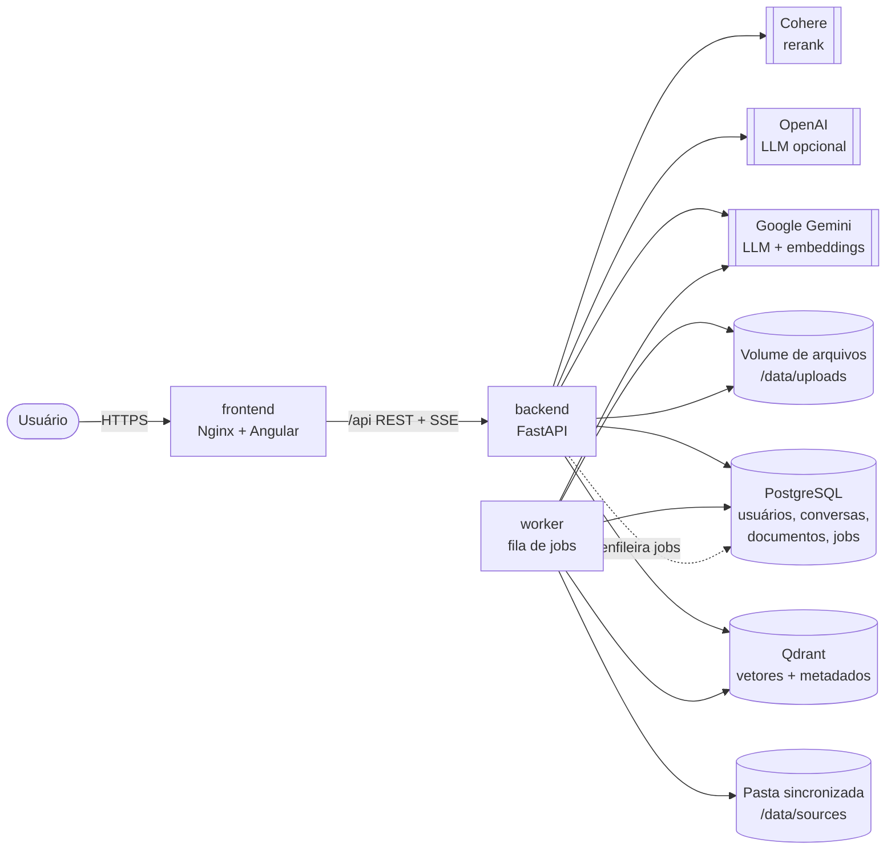
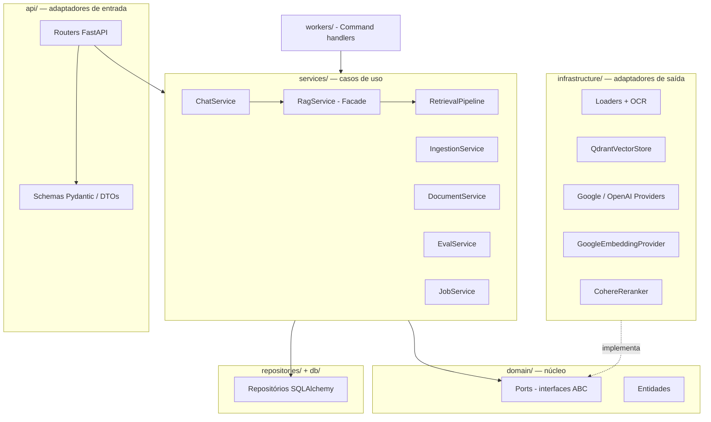
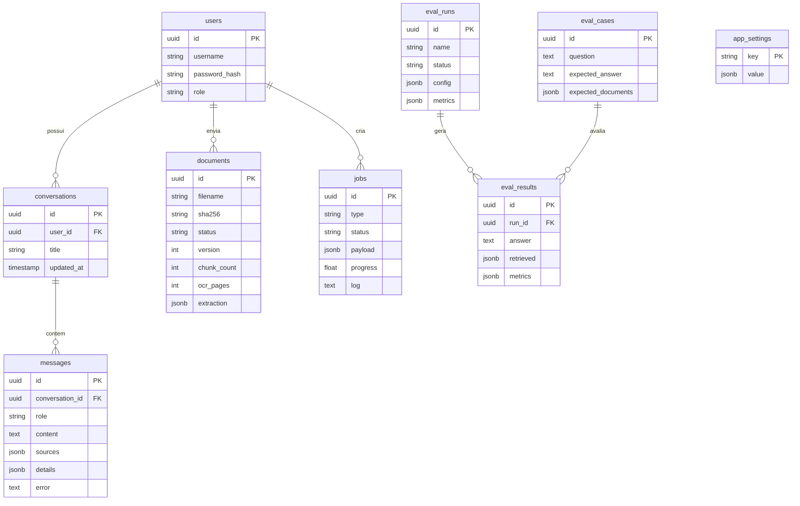

# 2. Arquitetura

## 2.1 Visão de contêineres



| Serviço | Imagem | Responsabilidade |
|---|---|---|
| `frontend` | `nginx:1.29-alpine` (build com `node:24-alpine`) | Servir a SPA Angular e encaminhar `/api` ao backend |
| `backend` | `python:3.12-slim` + Tesseract + LibreOffice | API REST, autenticação, chat com streaming |
| `worker` | mesma imagem do backend | Executar jobs: indexação, sincronização, avaliação |
| `postgres` | `postgres:17-alpine` | Dados relacionais e fila de jobs |
| `qdrant` | `qdrant/qdrant:v1.19.2` | Banco vetorial (HNSW, distância cosseno, 3072 dimensões) |

A fila de jobs usa o próprio PostgreSQL (`SELECT ... FOR UPDATE SKIP LOCKED`), evitando um *broker* adicional
(Redis/RabbitMQ) e mantendo o estado dos jobs consultável pela interface.

## 2.2 Camadas do backend (arquitetura hexagonal)



| Pasta | Conteúdo |
|---|---|
| `app/core` | Configuração (`pydantic-settings`), segurança (bcrypt, JWT), exceções, logging |
| `app/domain` | Entidades (`DocumentSection`, `Chunk`, `RetrievedChunk`...) e portas (`LLMProvider`, `VectorStore`...) |
| `app/db` | Modelos ORM, sessão e inicialização do banco |
| `app/repositories` | Repositórios por agregado (usuário, conversa, documento, job, avaliação) |
| `app/infrastructure` | Adaptadores: loaders, OCR, chunking, embeddings, LLMs, rerank, Qdrant, armazenamento |
| `app/services` | Casos de uso e pipelines (ingestão, RAG, chat, avaliação, sincronização) |
| `app/workers` | Worker de jobs e handlers por tipo de job |
| `app/api` | Rotas REST, dependências (autenticação) e DTOs |
| `app/container.py` | *Composition root*: monta e injeta os adaptadores |

Os serviços dependem apenas das **portas** do domínio. Trocar o Qdrant por outro banco vetorial ou o Gemini por
outro provedor exige somente um novo adaptador, sem alterar os casos de uso (princípio da inversão de dependência).

## 2.3 Frontend

```
src/app/
├── core/          modelos da API, serviços HTTP, interceptor JWT, guards, ChatStore (estado com signals)
├── shared/        ícones, logo, diálogos, pipes (markdown, datas, tamanhos)
├── layout/        shell (estrutura) e sidebar (conversas + rodapé administrativo)
└── features/
    ├── auth/      login
    ├── chat/      página do chat, caixa de mensagem, card da resposta, painel de fontes
    └── admin/     documentos, jobs, avaliação, modelos e RAG
```

- Componentes *standalone*, *signals* e aplicação sem `zone.js` (*zoneless*).
- Rotas com *lazy loading* e *guards* (`authGuard`, `adminGuard`).
- O chat lê a resposta via `fetch` + `ReadableStream`, interpretando os eventos SSE.

## 2.4 Modelo de dados relacional



## 2.5 Modelo de dados vetorial (Qdrant)

Coleção `mon_documents`: vetores de **3072 dimensões**, distância **cosseno**. Cada ponto (chunk) carrega:

| Campo do payload | Descrição | Indexado |
|---|---|---|
| `document_id` | ID do documento no PostgreSQL | sim (keyword) |
| `version` | Versão da indexação | sim (integer) |
| `filename`, `file_type` | Nome e tipo do arquivo | sim (keyword) |
| `chunk_index` | Posição do chunk no documento | — |
| `text` | Texto do chunk (usado no prompt e nas fontes) | — |
| `page`, `sheet`, `heading` | Localização (página/slide, aba, seção) | — |
| `ocr` | Se o texto veio de OCR | — |
| `source`, `sha256`, `indexed_at` | Origem, hash do arquivo e data de indexação | — |

O ID de cada ponto é um UUID v5 determinístico de `documento:versão:chunk`.
