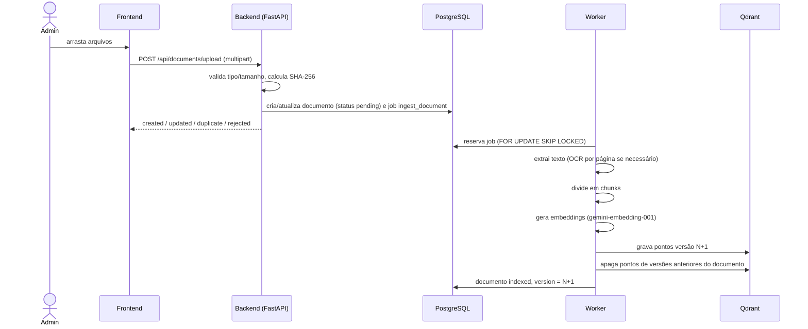

# 4. Ingestão de documentos e OCR

## 4.1 Fluxo geral

## 4.2 Regras do upload

| Situação | Resultado |
|---|---|
| Extensão não suportada, arquivo vazio ou > 100 MB | `rejected` |
| Conteúdo idêntico (mesmo SHA-256) a documento já existente | `duplicate` — nada é reprocessado |
| Mesmo nome de um documento já enviado, conteúdo diferente | `updated` — arquivo substituído e documento reindexado |
| Caso contrário | `created` — novo documento |

## 4.3 Extração por formato (Strategy + Factory)

| Extensões | Loader | Biblioteca | Unidade de seção |
|---|---|---|---|
| `.pdf` | `PdfLoader` | PyMuPDF + Tesseract | página |
| `.docx` | `DocxLoader` | python-docx | seção por título (parágrafos e tabelas em ordem) |
| `.doc`, `.rtf`, `.odt` | `LibreOfficeConvertingLoader` → `DocxLoader` | LibreOffice (headless) | idem |
| `.pptx` | `PptxLoader` | python-pptx | slide (inclui tabelas e notas) |
| `.ppt`, `.odp` | `LibreOfficeConvertingLoader` → `PptxLoader` | LibreOffice | slide |
| `.xlsx`, `.xlsm`, `.xls`, `.ods`, `.csv`, `.tsv` | `SpreadsheetLoader` | pandas, openpyxl, xlrd, odfpy | bloco de linhas por aba |
| `.txt`, `.md`, `.html`, `.xml`, `.json` | `TextLoader` | charset-normalizer | documento ou seção Markdown |
| `.png`, `.jpg`, `.tif(f)`, `.bmp`, `.webp` | `ImageLoader` | Pillow + Tesseract | imagem/quadro |

Todos herdam de `BaseLoader` (Template Method), que normaliza o texto: Unicode NFC, remoção de caracteres nulos,
junção de palavras hifenizadas na quebra de linha e compactação de espaços.

**Planilhas.** Cada linha vira pares `coluna: valor` (ex.: `Código: GEP101; Disciplina: Cálculo I`). Assim o
significado de cada célula entra no embedding, o que funciona melhor que CSV cru para busca semântica. As linhas
são agrupadas em blocos (~1200 caracteres) com o cabeçalho `Planilha <aba> (linhas a-b)` e nunca são quebradas
no meio.

**Codificação de texto.** Arquivos de texto são lidos como UTF-8; se falhar, a codificação é detectada entre
CP1252, Latin-1, CP850, MacRoman e UTF-16, comuns em arquivos brasileiros.

## 4.4 Detecção de páginas escaneadas

O PDF é analisado **página a página** por `HeuristicScanDetector` (`infrastructure/ocr/scan_detector.py`). Um
PDF misto (páginas digitais e digitalizadas) recebe OCR apenas onde precisa, sem perder conteúdo e sem gastar
processamento à toa.

Para cada página são medidos:

- **caracteres de texto nativo** extraídos pelo PyMuPDF;
- **cobertura de imagens**: área das imagens (interseção com a página) ÷ área da página;
- **taxa de caracteres inválidos**: proporção de caracteres de substituição (`U+FFFD`), de controle ou de uso
  privado — indica fontes sem mapeamento Unicode (texto "corrompido");
- **desenhos vetoriais**: número de objetos de desenho (texto convertido em curvas).

| Ordem | Regra | Decisão |
|---|---|---|
| 1 | Há texto, mas ≥ 30 % dos caracteres são inválidos | OCR — camada de texto corrompida |
| 2 | Menos de 50 caracteres e imagem cobrindo > 5 % da página | OCR — página escaneada |
| 3 | Imagens cobrem ≥ 50 % da página e há menos de 400 caracteres | OCR — página híbrida (ex.: só um carimbo digital) |
| 4 | Menos de 50 caracteres, sem imagem, com ≥ 300 desenhos vetoriais | OCR — texto vetorizado |
| 5 | Nenhum caractere e nada acima | Página em branco |
| 6 | Caso contrário | Texto nativo |

Quando a página vai para OCR, ela é renderizada a 300 DPI, convertida para tons de cinza com autocontraste e
processada pelo Tesseract (motor LSTM, `--oem 1 --psm 3`, idiomas `por+eng`). O sistema mantém o **texto mais
completo** entre o nativo e o do OCR. O relatório por página (motivo, caracteres, cobertura de imagem) fica salvo
em `documents.extraction.pages` e aparece na tela de documentos.

## 4.5 Chunking

`RecursiveTextChunker` divide cada seção usando o separador mais forte possível — parágrafo (`\n\n`), linha,
frase (`. `), ponto e vírgula, vírgula, espaço e, por último, caractere —, juntando pedaços até o limite
(padrão: **1200 caracteres**) com **sobreposição de 200 caracteres** entre chunks consecutivos. A sobreposição
evita que uma informação seja cortada exatamente na fronteira entre dois chunks.

Cada chunk herda os metadados da seção (página, aba, título, OCR), o que permite citar a localização exata.

## 4.6 Embeddings

- Modelo `gemini-embedding-001`, **3072 dimensões** (saída padrão, já normalizada), treinado com
  *Matryoshka Representation Learning* (Kusupati *et al.*, 2022; Lee *et al.*, 2025).
- Tipo de tarefa `RETRIEVAL_DOCUMENT` na indexação (com o nome do arquivo como `title`) e `RETRIEVAL_QUERY` na consulta.
- Chunks com título de seção recebem o título no texto vetorizado, dando contexto a trechos curtos.
- Lotes de 32 textos, com nova tentativa e espera exponencial (tenacity) em caso de limite de taxa.

## 4.7 Reindexação sem resíduos (versionamento)

Cada documento tem um campo `version`. Na indexação:

1. os novos pontos são gravados com `version = N + 1` (IDs determinísticos por documento, versão e chunk);
2. **só depois do sucesso**, os pontos do mesmo `document_id` com versão diferente de `N + 1` são apagados;
3. se qualquer etapa falhar, apenas os pontos parciais da versão `N + 1` são removidos e a versão `N` continua
   respondendo normalmente.

Assim a base nunca fica com trechos de versões antigas misturados aos novos, e o documento não fica
indisponível durante a reindexação. Excluir um documento remove todos os seus pontos do Qdrant (filtro por
`document_id`, campo indexado) e o arquivo armazenado.

## 4.8 Sincronização com a pasta de arquivos

O job `sync_folder` percorre `data/sources/` (montada no contêiner como somente leitura) e compara o SHA-256 de
cada arquivo com o registrado:

| Situação | Ação |
|---|---|
| Arquivo novo | cria documento (`source = folder`) e agenda indexação |
| Hash diferente (ou indexação anterior falhou) | agenda reindexação (versionada) |
| Arquivo removido da pasta | apaga documento e vetores |
| Sem alteração | nada |

O resumo (`added`, `updated`, `removed`, `unchanged`, `ignored`) fica no resultado do job.
