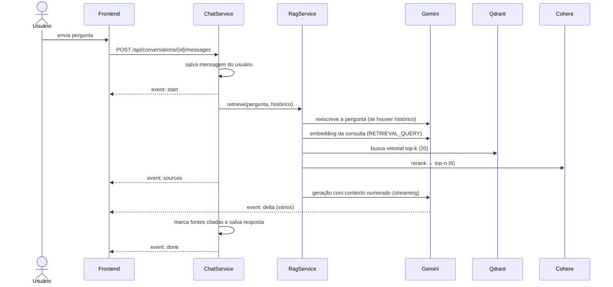

# 5. RAG e chat

## 5.1 Fluxo de uma pergunta



## 5.2 Pipeline de recuperação

O `RetrievalPipeline` executa etapas em sequência sobre um `RagContext` e registra o tempo de cada uma
(exibido no card da resposta):

1. **`QueryRewriteStep`** — se houver histórico, o LLM reescreve a pergunta como uma consulta autocontida
   ("e o prazo?" → "Qual o prazo de matrícula para o semestre 2026.1?"). Falhas aqui não interrompem a resposta.
2. **`VectorSearchStep`** — gera o embedding da consulta e busca os **k = 20** chunks mais próximos no Qdrant
   (similaridade de cosseno sobre índice HNSW; Malkov e Yashunin, 2020).
3. **`RerankStep`** — o modelo de rerank da Cohere (*cross-encoder*; Nogueira e Cho, 2019) reavalia cada par
   (pergunta, chunk) e mantém os **n = 6** mais relevantes, descartando os abaixo da relevância mínima configurada.

A busca vetorial é rápida, mas aproximada; o rerank é mais preciso, mas caro. Combinar os dois (recuperar muitos e
reordenar poucos) é a abordagem em dois estágios usual em recuperação de informação. Enviar ao modelo apenas
poucos trechos muito relevantes também reduz a perda de informação em contextos longos (Liu *et al.*, 2024).

## 5.3 Prompt

Montado pelo `PromptBuilder`:

- **Instrução de sistema**: nome do assistente + persona (editável, padrão em `SYSTEM_PROMPT.md`) + regras fixas:
  responder em português, usar somente o contexto, citar com `[n]`, admitir quando não encontrar, usar Markdown.
- **Histórico**: últimas mensagens da conversa (padrão 6), sem o contexto de turnos anteriores.
- **Última mensagem**: bloco `<contexto>` com os trechos numerados e a localização de cada um, seguido da pergunta.

```
<contexto>
[1] Fonte: regulamento-estagio.pdf, página 4
Art. 12. O estágio supervisionado obrigatório terá carga horária mínima de 160 horas...

[2] Fonte: calendario-academico.xlsx, planilha 2026.1
Evento: Entrega de relatórios; Data: 30/06/2026
</contexto>

Pergunta: Qual a carga horária mínima do estágio?
```

No Gemini 3.8 Flash é usado o nível de raciocínio configurável (`thinking_level`: low, medium, high) e a
temperatura não é definida, conforme a recomendação do provedor para a família Gemini 3. Nos modelos de raciocínio
da OpenAI (GPT-5, série o) é usado `reasoning.effort`.

## 5.4 Streaming (Server-Sent Events)

A resposta é enviada como `text/event-stream`:

| Evento | Conteúdo |
|---|---|
| `start` | mensagem do usuário salva e título da conversa |
| `sources` | metadados dos trechos recuperados (antes da geração) |
| `delta` | fragmento de texto gerado |
| `done` | mensagem final do assistente salva (com fontes marcadas como citadas) |
| `error` | mensagem de erro amigável |

O Nginx repassa o stream sem buffer (`proxy_buffering off`). Se o usuário interromper, o texto parcial é salvo.

## 5.5 Fontes consultadas

Cada fonte guarda: número do trecho, `document_id`, nome e tipo do arquivo, página/slide, aba, título da seção,
índice do chunk, se veio de OCR, pontuação vetorial, pontuação de rerank e um trecho do texto.

Depois da geração, as marcações `[n]` da resposta indicam quais trechos foram **citados**. A interface mostra:

- **Fontes consultadas** — documentos citados, agrupados, com páginas, selo de OCR, relevância e botão de download;
  ao expandir, os trechos exatos;
- **Outros trechos recuperados** — o restante do contexto, recolhido por padrão.

As citações no texto aparecem como selos numerados que correspondem às fontes.

## 5.6 Seleção de modelos

A tela **Modelos e RAG** lista, em tempo real, os modelos disponíveis em cada provedor:

- **Google**: `models.list()` filtrado por modelos que suportam `generateContent` (exclui embeddings, imagem, áudio, TTS);
- **OpenAI**: `models.list()` filtrado por famílias de chat (`gpt-*`, `o1/o3/o4`, `chatgpt-*`).

O administrador pode **testar** um modelo (latência e resposta) e **usá-lo** no Mon. A escolha fica em
`app_settings` e vale imediatamente. O modelo de embeddings é fixo por configuração, pois trocá-lo exige
reindexar toda a base.
