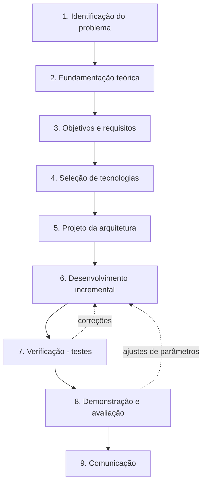

# 11. Metodologia: passo a passo do desenvolvimento do Mon

Este documento descreve, em ordem, como o projeto foi concebido, construído e verificado, servindo de base para
o capítulo de **Metodologia** do TCC. As seções marcadas como **[a executar]** dependem de dados reais (documentos
da instituição, chaves de API, participantes) e devem ser preenchidas com os resultados obtidos.

---

## 1. Caracterização da pesquisa

| Critério | Classificação | Justificativa |
|---|---|---|
| Natureza | Aplicada | Busca resolver um problema concreto: o acesso à informação em documentos institucionais. |
| Abordagem | Quali-quantitativa | Métricas numéricas de recuperação, qualidade das respostas e tempo, complementadas por análise qualitativa das respostas. |
| Objetivos | Exploratória e prescritiva | Explora a aplicação de RAG ao contexto acadêmico e prescreve um artefato (sistema) para o problema. |
| Procedimentos | *Design Science Research* (DSR), pesquisa bibliográfica e experimento | O resultado principal é um artefato avaliado de forma sistemática. |

O método adotado é a **Design Science Research**, que orienta a construção e a avaliação de artefatos para
resolver problemas reais (Hevner *et al.*, 2004; Dresch, Lacerda e Antunes Júnior, 2015). O desenvolvimento
seguiu as seis atividades do processo DSRM de Peffers *et al.* (2007), detalhadas nas etapas a seguir.

---

## 2. Visão geral das etapas

| Atividade DSRM (Peffers *et al.*, 2007) | Etapa deste trabalho | Artefato ou evidência |
|---|---|---|
| Identificação do problema e motivação | 1. Identificação do problema | Seção 1 de [01-visao-geral.md](01-visao-geral.md) |
| Definição dos objetivos da solução | 2. Fundamentação teórica e 3. Requisitos | Requisitos RF01–RF10 e RNF01–RNF05 |
| Projeto e desenvolvimento | 4. Tecnologias, 5. Arquitetura e 6. Desenvolvimento | Código em `backend/` e `frontend/`; [02-arquitetura.md](02-arquitetura.md) |
| Demonstração | 7. Verificação e 8. Demonstração | Testes automatizados e uso do sistema com documentos reais |
| Avaliação | 8. Avaliação | Módulo de avaliação do RAG e protocolo experimental |
| Comunicação | 9. Comunicação | Documentação em `docs/`, repositório e o próprio TCC |

---

## 3. Etapa 1: identificação do problema

**Procedimento**

1. Levantamento dos tipos de documento que estudantes e servidores consultam: editais, regulamentos,
   resoluções, calendários, planilhas de disciplinas e atas digitalizadas.
2. Caracterização das dificuldades: informação dispersa, formatos heterogêneos (PDF, Word, Excel, imagens),
   documentos escaneados sem texto pesquisável e necessidade de saber previamente onde procurar.
3. Enquadramento do problema na Engenharia de Produção como um problema de **gestão do conhecimento**
   (Nonaka e Takeuchi, 1995; Davenport e Prusak, 1998) e de **eficiência do processo de atendimento**: tempo
   gasto para localizar uma informação e retrabalho com dúvidas repetidas.

**Resultado**: definição do problema e do contexto (CEFET/RJ), descritos em [01-visao-geral.md](01-visao-geral.md).

**[a executar]** Para fortalecer a motivação: entrevista curta ou questionário com a secretaria ou a
coordenação sobre as dúvidas mais frequentes e o tempo médio de resposta, ou registro de uma amostra de dúvidas
recebidas.

---

## 4. Etapa 2: fundamentação teórica

Pesquisa bibliográfica sobre os conceitos que sustentam a solução:

| Tema | Conceitos estudados | Referências principais |
|---|---|---|
| Modelos de linguagem | Arquitetura Transformer, LLMs, alucinação | Vaswani *et al.* (2017) |
| RAG | Recuperação + geração; respostas fundamentadas em documentos externos | Lewis *et al.* (2020); Gao *et al.* (2023) |
| Representação vetorial | Embeddings densos, similaridade de cosseno, Matryoshka | Kusupati *et al.* (2022); Lee *et al.* (2025) |
| Busca vetorial | Índices aproximados HNSW | Malkov e Yashunin (2020) |
| Reordenação | Cross-encoders e recuperação em dois estágios | Nogueira e Cho (2019); Manning, Raghavan e Schütze (2008) |
| Contexto do LLM | Efeito de contextos longos | Liu *et al.* (2024) |
| OCR | Reconhecimento óptico de caracteres com redes LSTM | Smith (2007) |
| Avaliação | MRR, recall, LLM como juiz, métricas RAGAS | Voorhees (1999); Es *et al.* (2024); Zheng *et al.* (2023) |
| Engenharia de software | Padrões de projeto, arquitetura em camadas e hexagonal | Gamma *et al.* (1994); Fowler (2002); Cockburn (2005); Martin (2017) |

**Resultado**: base conceitual que orientou as decisões das etapas seguintes. As referências completas estão em
[09-referencias.md](09-referencias.md).

---

## 5. Etapa 3: definição dos objetivos e requisitos

**Procedimento**

1. Tradução do problema em **objetivos da solução**: responder em linguagem natural, apenas com base nos
   documentos e mostrando as fontes.
2. Elicitação dos **requisitos funcionais** (RF01–RF10) e **não funcionais** (RNF01–RNF05), seguindo as
   práticas de engenharia de requisitos (Sommerville, 2019).
3. Definição explícita do **escopo** e do que ficou como trabalho futuro.

**Decisões de requisito relevantes para o texto**

- **Transparência**: toda resposta deve trazer as "fontes consultadas" (arquivo, página, trecho), permitindo ao
  usuário verificar a informação.
- **Fidelidade**: o assistente deve admitir quando a informação não está nos documentos, em vez de inventar.
- **Cobertura de documentos escaneados**: a detecção de páginas escaneadas deve ser feita por página, para não
  perder conteúdo de PDFs mistos.
- **Integridade da base**: ao atualizar um documento, nenhum vestígio da versão anterior pode permanecer.
- **Mensurabilidade**: o sistema deve incluir um módulo de avaliação para medir a própria qualidade.

**Resultado**: tabela de requisitos em [01-visao-geral.md](01-visao-geral.md).

---

## 6. Etapa 4: seleção de tecnologias

**Critérios adotados**: (i) adequação técnica ao requisito; (ii) suporte ao português; (iii) maturidade e
documentação; (iv) licença compatível com uso acadêmico; (v) custo; (vi) facilidade de execução local com Docker.

| Necessidade | Escolha | Alternativas consideradas | Justificativa |
|---|---|---|---|
| Linguagem do backend | Python 3.12 | Node.js, Java | Ecossistema mais amplo para IA, OCR e leitura de documentos |
| Framework da API | FastAPI | Flask, Django | Validação com Pydantic, OpenAPI automática, suporte a streaming |
| Frontend | Angular 22 | React, Vue | Framework completo (roteamento, DI, formulários), tipagem forte |
| Banco relacional | PostgreSQL 17 | MySQL, SQLite | Robustez, JSONB e `SKIP LOCKED`, que permite usá-lo também como fila de jobs |
| Banco vetorial | Qdrant | pgvector, Chroma, Weaviate | Filtros por metadados indexados (essenciais para reindexar por documento), HNSW, código aberto |
| LLM | Gemini 3.8 Flash | GPT-5, modelos locais | Baixa latência e custo, contexto longo, bom desempenho em português; troca por OpenAI via interface |
| Embeddings | gemini-embedding-001 (3072 dim.) | text-embedding-3-large, modelos locais | Multilíngue, alta dimensionalidade, mesmo provedor do LLM |
| Rerank | Cohere rerank-v4.0-pro | cross-encoder local, sem rerank | Multilíngue, alta qualidade, sem necessidade de GPU |
| OCR | Tesseract 5 (por+eng) | OCR em nuvem, OCR multimodal com LLM | Código aberto, execução local, sem custo por página |
| Formatos legados | LibreOffice headless | antiword, conversão manual | Converte .doc, .rtf, .odt e .ppt de forma confiável |
| Implantação | Docker Compose | instalação manual | Reprodutibilidade do ambiente (RNF01) |

**Resultado**: pilha tecnológica e versões em [08-dependencias.md](08-dependencias.md).

---

## 7. Etapa 5: projeto da arquitetura

**Procedimento**

1. Definição da **arquitetura de contêineres**: frontend (Nginx), backend (API), worker (tarefas assíncronas),
   PostgreSQL e Qdrant.
2. Adoção da **arquitetura hexagonal** (Cockburn, 2005) no backend: o núcleo depende apenas de interfaces
   (portas) e cada serviço externo (Gemini, OpenAI, Cohere, Qdrant, Tesseract) é um adaptador substituível.
3. Separação do **processamento pesado** (OCR, embeddings) em um worker com fila de jobs, mantendo a interface
   responsiva (RNF03).
4. Modelagem dos **dados relacionais** (usuários, conversas, mensagens, documentos, jobs, avaliações) e do
   **payload vetorial** (metadados de cada trecho no Qdrant).
5. Escolha dos **padrões de projeto** para cada ponto de variação: Strategy para os leitores de arquivo,
   Factory para provedores, Pipeline para a recuperação, Command para os jobs, entre outros.

**Resultado**: diagramas em [02-arquitetura.md](02-arquitetura.md) e catálogo de padrões em
[03-padroes-de-projeto.md](03-padroes-de-projeto.md).

---

## 8. Etapa 6: desenvolvimento incremental

O sistema foi construído em incrementos, cada um verificado antes do seguinte (Sommerville, 2019).

### 8.1 Incremento 1: núcleo e persistência

- Configuração por variáveis de ambiente, segurança (hash bcrypt, tokens JWT) e tratamento de erros.
- Modelos de dados com SQLAlchemy e repositórios por entidade (padrão Repository).
- Interfaces do domínio (portas): `LLMProvider`, `EmbeddingProvider`, `Reranker`, `VectorStore`,
  `DocumentLoader`, `OcrEngine`, `TextChunker`.

### 8.2 Incremento 2: adaptadores de infraestrutura

- Cliente do Qdrant: coleção de 3072 dimensões com distância de cosseno e índices nos campos `document_id`,
  `version`, `filename` e `file_type`.
- Provedores de LLM (Gemini e OpenAI), embeddings (Gemini) e rerank (Cohere), com novas tentativas e espera
  exponencial para limites de taxa.

### 8.3 Incremento 3: pipeline de ingestão

1. **Extração por formato**: um leitor por tipo de arquivo, escolhido pela extensão (Strategy + Factory).
   Planilhas são convertidas em pares "coluna: valor" por linha, preservando o significado das células.
2. **Detecção de páginas escaneadas** (por página do PDF): mede a quantidade de texto nativo, a cobertura de
   imagens, a proporção de caracteres inválidos e a quantidade de desenhos vetoriais. Regras (em ordem):

   | Condição | Decisão |
   |---|---|
   | ≥ 30 % de caracteres inválidos | OCR (texto corrompido) |
   | < 50 caracteres e imagem cobrindo > 5 % da página | OCR (página escaneada) |
   | Imagens cobrindo ≥ 50 % e < 400 caracteres | OCR (página híbrida) |
   | < 50 caracteres, sem imagem, ≥ 300 desenhos vetoriais | OCR (texto vetorizado) |
   | Nenhum texto e nada acima | Página em branco |
   | Demais casos | Texto nativo |

3. **OCR**: renderização da página a 300 DPI, tons de cinza com autocontraste e Tesseract (`por+eng`). O sistema
   mantém o texto mais completo entre o nativo e o reconhecido.
4. **Divisão em trechos (chunking)**: divisão recursiva por parágrafo, linha, frase e palavra, com trechos de
   até 1200 caracteres e sobreposição de 200.
5. **Vetorização**: embeddings de 3072 dimensões em lotes de 32 trechos.
6. **Indexação versionada**: os novos vetores são gravados com a versão N+1 e só então os da versão anterior
   são apagados. Em caso de falha, apenas os vetores parciais são removidos e a versão anterior continua ativa.
7. **Controle de duplicidade**: o hash SHA-256 do arquivo identifica conteúdo idêntico, e o mesmo nome com
   conteúdo novo gera uma nova versão.

### 8.4 Incremento 4: pipeline de recuperação e geração (RAG)

1. **Reescrita da pergunta** com base no histórico da conversa (perguntas de acompanhamento).
2. **Busca vetorial** dos 20 trechos mais similares (top-k).
3. **Rerank** e seleção dos 6 mais relevantes (top-n).
4. **Montagem do prompt**: persona + regras (usar só o contexto, citar com [n], admitir quando não souber) +
   trechos numerados com sua localização + pergunta.
5. **Geração em streaming** (Server-Sent Events) e marcação das fontes efetivamente citadas na resposta.
6. Registro de metadados por resposta: modelo, consulta usada na busca e tempo de cada etapa.

### 8.5 Incremento 5: API, autenticação e processamento assíncrono

- Rotas REST para autenticação, conversas, documentos, jobs, configurações e avaliação.
- Worker que consome a fila de jobs no PostgreSQL (`FOR UPDATE SKIP LOCKED`) com progresso e log por job.
- Sincronização com a pasta `data/sources`: arquivos novos, alterados e removidos.

### 8.6 Incremento 6: interface do usuário

- Tela de login; tela de chat com histórico na barra lateral e o card de resposta com "Fontes consultadas".
- Área administrativa: envio de documentos por arrastar e soltar, acompanhamento de jobs, avaliação do RAG e
  seleção de modelos e parâmetros.

### 8.7 Incremento 7: conteinerização e documentação

- Imagens Docker para backend (com Tesseract e LibreOffice) e frontend (build Angular servido pelo Nginx).
- Orquestração dos cinco serviços com Docker Compose.
- Documentação técnica em `docs/`.

**Resultado**: o artefato (sistema Mon) versionado no repositório Git.

---

## 9. Etapa 7: verificação

| Tipo de verificação | Procedimento | Resultado |
|---|---|---|
| Testes unitários (20) | pytest sobre chunking, detecção de páginas escaneadas (PDF sintético com páginas digital, escaneada, em branco e híbrida), leitores de DOCX, planilhas, CSV em Latin-1 e Markdown, métricas de avaliação, citações, prompt e segurança | Todos aprovados |
| Teste de integração (1) | Fluxo completo com PostgreSQL e Qdrant reais e provedores de IA simulados: ingestão → duplicidade → nova versão (confirmando a remoção dos vetores antigos) → resposta com citação → métricas → exclusão | Aprovado |
| Teste do OCR em contêiner | PDF misto (1 página digital e 1 escaneada): OCR aplicado só na página escaneada, com texto reconhecido corretamente | Aprovado |
| Teste de conversão | Arquivo .doc convertido pelo LibreOffice e lido corretamente | Aprovado |
| Testes de API | Login, conversas, streaming SSE, upload (novo, duplicado, rejeitado) e tratamento de chave ausente | Aprovados |
| Testes de interface | Navegador automatizado (Playwright) percorrendo todas as telas em desktop e celular, sem erros no console | Aprovados |

Comandos para reproduzir: seção 10.5 de [10-execucao.md](10-execucao.md).

---

## 10. Etapa 8: demonstração e avaliação **[a executar]**

### 10.1 Corpus de documentos

1. Selecionar um conjunto representativo de documentos públicos do CEFET/RJ (ex.: 20 a 50 arquivos), cobrindo
   PDFs digitais, PDFs escaneados, planilhas e documentos Word.
2. Registrar a composição do corpus: quantidade por formato, páginas, páginas com OCR e trechos gerados. Esses
   dados aparecem na tela **Documentos** e nos jobs de indexação.

### 10.2 Conjunto de perguntas de teste

1. Elaborar de 30 a 50 perguntas reais (ex.: dúvidas frequentes da secretaria), cada uma com **resposta de
   referência** validada e **documentos esperados**.
2. Incluir perguntas de categorias diferentes: fatos simples, dados de planilha, conteúdo de documento
   escaneado e perguntas **sem resposta na base**, para testar se o sistema admite não saber.
3. Opcionalmente, complementar com casos gerados sinteticamente (botão **Gerar casos sintéticos**), sempre
   revisados manualmente.

### 10.3 Métricas

| Dimensão | Métrica | Fonte |
|---|---|---|
| Recuperação | Hit rate, MRR, recall e precisão de contexto | Módulo de avaliação (cálculo automático) |
| Geração | Fidelidade, relevância e correção (0 a 1) | LLM como juiz (módulo de avaliação) |
| Desempenho | Latência média e percentil 95 | Módulo de avaliação |
| Ingestão | Páginas com OCR / total; tempo de indexação por documento | Telas de Documentos e Jobs |

Definições formais em [06-avaliacao.md](06-avaliacao.md).

### 10.4 Desenho experimental

Avaliar uma configuração de referência e variar **um fator por vez**, mantendo o mesmo conjunto de perguntas e
o mesmo juiz:

| Experimento | Configuração | Pergunta de pesquisa |
|---|---|---|
| E0 (linha de base) | Gemini 3.8 Flash, top-k 20, rerank ligado, top-n 6, chunk 1200/200 | Qual o desempenho do sistema proposto? |
| E1 | E0 sem rerank | Quanto o rerank contribui para a qualidade? |
| E2 | E0 com top-n 3 e top-n 10 | Qual a quantidade ideal de trechos no contexto? |
| E3 | E0 com chunk 600/100 e 2000/300 (reindexar) | Como o tamanho do trecho afeta recuperação e resposta? |
| E4 | E0 com outro LLM (ex.: modelo da OpenAI) | O desempenho depende do modelo de linguagem? |
| E5 | E0, analisando só as perguntas cujas respostas estão em páginas escaneadas | Qual o ganho do OCR seletivo? (sem OCR essas páginas não teriam texto indexável) |

Cada execução fica registrada com sua configuração na tela **Avaliação do RAG**. Os resultados detalhados por
pergunta podem ser obtidos em JSON pela API (`GET /api/evals/runs/{id}`).

### 10.5 Análise dos resultados

1. Reportar média e desvio padrão de cada métrica por experimento.
2. Comparar configurações com teste pareado não paramétrico (Wilcoxon, 1945), pois as mesmas perguntas são usadas
   em todas as execuções.
3. Análise qualitativa: selecionar exemplos de acertos, erros de recuperação, alucinações e respostas "não
   encontrado", relacionando cada erro à sua causa (OCR, chunking, rerank, geração).

### 10.6 Avaliações complementares (opcionais)

- **Estudo de tempo**: alguns participantes respondem um conjunto de perguntas (a) procurando nos documentos
  manualmente e (b) usando o Mon. Comparar o tempo médio e a taxa de acerto, conectando o resultado à
  eficiência do processo, tema central da Engenharia de Produção.
- **Usabilidade**: aplicar o questionário SUS (*System Usability Scale*; Brooke, 1996) após o uso do sistema.

### 10.7 Ameaças à validade

- O juiz automático é um LLM e pode ter vieses. Mitigação: validar manualmente uma amostra das notas.
- As perguntas podem não representar todas as dúvidas reais. Mitigação: usar perguntas coletadas da secretaria.
- Os modelos dos provedores mudam com o tempo. Mitigação: registrar a versão do modelo e a data de cada execução.
- A qualidade do OCR depende da digitalização. Mitigação: relatar a proporção de páginas escaneadas no corpus.

---

## 11. Etapa 9: comunicação

- Documentação técnica completa em `docs/` (arquitetura, padrões, pipelines, avaliação, API, dependências).
- Código-fonte versionado em repositório Git, com histórico de commits por incremento.
- Texto do TCC e apresentação, com os resultados da etapa 8.

---

## 12. Quadro-resumo da metodologia

Para uso direto no texto:

| Etapa | Procedimento | Técnicas e ferramentas | Resultado |
|---|---|---|---|
| 1. Problema | Levantamento do contexto e das dificuldades de acesso à informação | Análise documental, entrevista/questionário | Problema delimitado |
| 2. Fundamentação | Pesquisa bibliográfica | Artigos científicos e documentação técnica | Base conceitual |
| 3. Requisitos | Elicitação de requisitos funcionais e não funcionais | Engenharia de requisitos | RF01–RF10, RNF01–RNF05 |
| 4. Tecnologias | Comparação de alternativas por critérios | Matriz de decisão | Pilha tecnológica |
| 5. Arquitetura | Projeto de contêineres, camadas e dados | Arquitetura hexagonal, padrões de projeto, UML/Mermaid | Modelo arquitetural |
| 6. Desenvolvimento | Construção em 7 incrementos | Python/FastAPI, Angular, PostgreSQL, Qdrant, Gemini, Cohere, Tesseract, Docker | Sistema Mon |
| 7. Verificação | Testes automatizados e manuais | pytest, Playwright, testes de API | 21 testes aprovados |
| 8. Avaliação | Experimentos com perguntas de referência | Hit rate, MRR, recall, LLM como juiz, latência, Wilcoxon, SUS | Resultados (a executar) |
| 9. Comunicação | Documentação e redação | Markdown, Git | Documentação e TCC |

---

## 13. Referências da metodologia

BROOKE, John. SUS: a "quick and dirty" usability scale. *In*: JORDAN, Patrick W. *et al*. (ed.). **Usability evaluation in industry**. London: Taylor & Francis, 1996. p. 189-194.

DRESCH, Aline; LACERDA, Daniel Pacheco; ANTUNES JÚNIOR, José Antonio Valle. **Design science research**: método de pesquisa para avanço da ciência e tecnologia. Porto Alegre: Bookman, 2015.

GIL, Antonio Carlos. **Como elaborar projetos de pesquisa**. 6. ed. São Paulo: Atlas, 2017.

HEVNER, Alan R.; MARCH, Salvatore T.; PARK, Jinsoo; RAM, Sudha. Design science in information systems research. **MIS Quarterly**, v. 28, n. 1, p. 75-105, 2004.

PEFFERS, Ken; TUUNANEN, Tuure; ROTHENBERGER, Marcus A.; CHATTERJEE, Samir. A design science research methodology for information systems research. **Journal of Management Information Systems**, v. 24, n. 3, p. 45-77, 2007.

SOMMERVILLE, Ian. **Engenharia de software**. 10. ed. São Paulo: Pearson, 2019.

WILCOXON, Frank. Individual comparisons by ranking methods. **Biometrics Bulletin**, v. 1, n. 6, p. 80-83, 1945.

As demais referências citadas estão em [09-referencias.md](09-referencias.md).
